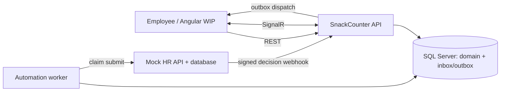

# Snack Counter Automation: Design

## Scope and features

The assignment asks for a working refill lifecycle, volunteer selection, budget checks, simulated chat and HR integrations, and tests for contention, handoff, and multi-currency reporting. The implementation is a .NET API with SQL Server persistence and a separate Mock HR service. Angular/UI integration is a work in progress.

**Functional:** open an empty-item request; offer it to one eligible volunteer; confirm availability and office; record a restock and office-currency spend; submit a reimbursement claim; process an HR decision; show durable chat/notification updates; report monthly spend by office and currency. Employees may work across offices; leave, work-from-home, wrong location, existing work, daily prior offers, and monthly workload affect selection.

**Non-functional:** authenticated employee/HR/manager roles; office and employee scoping; optimistic row-version checks; transactional persistence of business changes and outbox events; idempotent claim/webhook handling; retryable background delivery; explicit office time zones and currencies. This is an interview-scale demo: development auth, simulated FX, local SQL configuration, and no production identity, object storage, or multi-instance deployment guarantees.

## High-level design

The API is a modular monolith. SQL holds authoritative refill, inventory, budget, claim, message, and notification state. Chat is a durable view of business events; SignalR accelerates delivery while REST/inbox history supports reconnects.

## Refill to reimbursement

1. An employee opens a request for an empty item. The API checks item state and active requests within a transaction ([`OpenRefill`](Controllers/RefillOperationsController.cs#L179)).
2. The worker ranks open requests by prior-month consumption and selects an available volunteer by completed work, offers, then employee ID. Active office roster membership, leave, WFH, existing assignment, and offers already made that day constrain eligibility ([`OfferNextEmployeeAsync`](Infrastructure/SnackCounterAutomationWorker.cs#L171)).
3. The offer temporarily assigns the refill. The recipient must acknowledge and accept from the correct physical office; row versions and database concurrency checks prevent two employees from committing the same refill ([claim](Controllers/RefillOperationsController.cs#L231), [accept](Controllers/RefillOperationsController.cs#L339)). A declined or expired offer returns to the shared queue; the worker offers it to the next eligible employee ([`ReleaseExpiredClaimAsync`](Infrastructure/SnackCounterAutomationWorker.cs#L304)).
4. The assigned volunteer records quantity, purchase amount, description, and optional receipt. One transaction updates stock, refill, and office-month spend; purchase currency is the office currency. The monthly budget check rejects spending over the limit ([`CompleteRefill`](Controllers/RefillOperationsController.cs#L425)).
5. The employee submits a purchase-linked claim. The API persists it with an HR notification and outbox submission; Mock HR deduplicates by claim ID. HR decisions return via an HMAC-signed webhook; event IDs prevent duplicate processing, and the employee receives a durable notification ([`SubmitClaim`](Controllers/PeopleOperationsController.cs#L125), [webhook](Controllers/ExternalHrWebhookController.cs#L25)).

## Data and key decisions

Core records are in [`SnackCounterEntities.cs`](Domain/SnackCounterEntities.cs): `SnackItem` and `StockMovement` model stock; `Refill` and `RefillAssignmentAttempt` model queue and offer history; `MonthlyBudget` tracks office/month spend; `ReimbursementClaim` models HR status; `ConversationMessage`, `Notification`, and `OutboxMessage` support chat delivery. The older compact domain model is in [`Refill.cs`](Domain/Refill.cs). EF mappings and constraints live in `Infrastructure/SnackCounterEntityConfigurations.cs`.

The shared office queue avoids permanently assigning work to someone who is away. Timed, single-person offers balance fairness with immediate ownership; daily attempt limits avoid repeatedly paging the same roster. Row versions protect a refill/item from concurrent edits, and transactions keep stock and budget writes together. Office budgets are never summed as if currencies match: reports retain NOK and INR totals separately and optionally convert the combined figure using the configured demo FX table ([report service](Application/MonthlySpendingReport.cs)).

The HR service is a local stand-in, not a provider-specific integration. Durable outboxes decouple chat and HR outages from the refill transaction; webhook signatures authenticate callbacks and event IDs make retries safe. The trade-off is extra persistence and eventual delivery instead of an immediate distributed transaction. The UI remains WIP. Codex assisted implementation and review; the anti-slop plugin guided the UI work.

## Tests

The NUnit suite covers competing claims, expiry and reassignment, budget boundaries, NOK/INR totals, purchase-linked claim retries, and signed webhook deduplication. [`SnackCounterRulesTests.cs`](tests/API.SnackCounter.Tests/SnackCounterRulesTests.cs) includes a commented open-to-reimbursed lifecycle walkthrough. Tests use EF Core InMemory for the persisted API scenarios; the legacy lifecycle test uses its thread-safe in-memory store.
